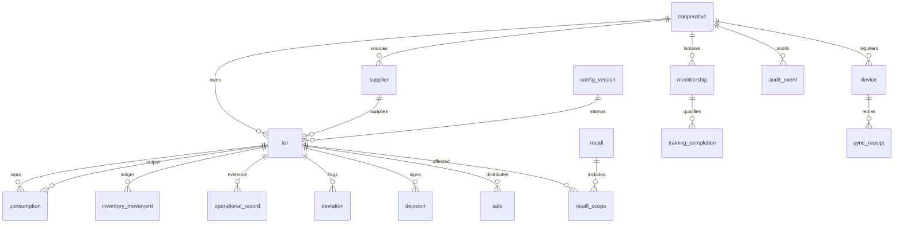

# WISE data model

All operational entities use UUID primary keys, cooperative foreign keys, author/device attribution, observed and recorded timestamps and config-version references. Lot types are whey, ingredient, packaging_material, batch and packaging. UUIDs are stable; server sequences confirm readable codes; public identifiers are random opaque tokens.

`lot` holds source/production facts and lifecycle, never editable remaining quantity. `consumption` is append-only directed input→output quantity/unit with cycle prevention and row-lock allocation checks. `inventory_movement` is append-only signed deltas; receipts and production are positive, outgoing movements negative, returns positive, adjustments carry reasons. Available stock is movement sum minus consumption; same-unit constraints forbid implicit conversion. Packaging has kg for genealogy and package count for sales, so these balances must be separate.

`config_version` contains kind, version, scope, effective dates, JSON rule definitions, placeholder flag, drafter and approver. Food-safety drafts cannot become active without a different Food-Safety Lead approving. Operational records bind the exact effective version. Stage/checkpoint requirements, thresholds, shelf life, training and label lists are data.

Separate tables: cooperative/sites, membership and authorizations, restricted producer_profile/consent, devices, suppliers/standing declarations, training modules/completions/exceptions, equipment/calibration, stage runs, checkpoints/measurements, samples/labs, deviations/CAPA, tasks, packaging detail, sale and rate, storage/inspection, recall/actions, notifications, attachments, amendments, signoffs and sync receipts/conflicts. Flexible operational-record payloads can carry evolving evidence but do not replace constrained ledger rows or permission checks.

`audit_event` is trigger-written field-level history with old/new JSON, author, device, observed/recorded time and reason. App roles cannot insert, update or delete it. Released/rejected/recalled row edits fail; amendments refer to originals. State history supports observed-time sync validation. Security-definer routines use fixed search paths, explicit authorization and restricted grants.

Recursive genealogy queries traverse consumption with visited UUID paths. Index both edge endpoints, cooperative/time, task due/status, sale packaging lot and audit object/time. KPI-01–13 dictionary is copied verbatim from the PRD; calculations derive from ledgers, released-batch allocations, qualifying activities, current training and stored exchange rates. Donor functions return only allowed aggregates with participant suppression.
