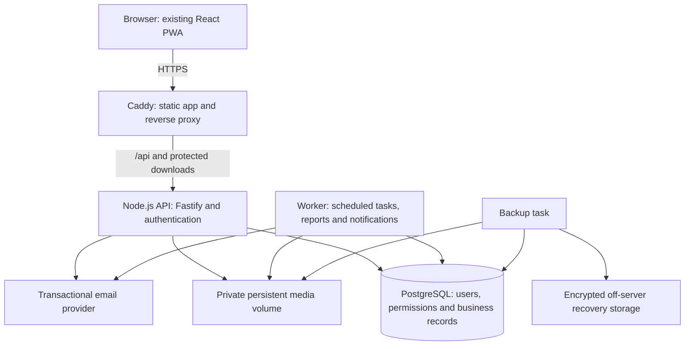

# WISE: independent VPS deployment plan

Prepared 20 October 2026. Target: your own cloud virtual machine, PostgreSQL and an application backend under your control. Supabase software and Supabase Cloud are excluded from the target architecture. Cloudflare hosting is optional and is not required by this plan.

**Status:** this is the migration and deployment plan. The current application still depends on Supabase. The replacement backend, Docker deployment package and production recovery drill have not been implemented or tested. Existing application test results do not establish readiness of the replacement system.

## 1. Choose the server and understand the free budget

Recommended starting candidate: Oracle Cloud Always Free, Ubuntu 24.04 LTS on an Ampere A1 ARM VM. Oracle currently documents an Always Free tenancy allowance equivalent to 2 OCPUs and 12 GB RAM, plus 200 GB of combined boot/block storage. Use one VM, initially with about 80 GB disk, leaving allocation available for growth. Confirm the console labels and total allocated resources before creating anything. [Oracle resource limits](https://docs.oracle.com/en-us/iaas/Content/FreeTier/freetier_topic-Always_Free_Resources.htm)

Capacity is not guaranteed. Oracle can reclaim idle free instances. Keep an independent recovery copy and be prepared to restore onto another server. If A1 capacity is unavailable, wait or select a paid VPS within an agreed budget; a short promotional credit is not a permanent free allowance. Do not generate artificial activity to avoid reclamation. [Oracle conditions](https://docs.oracle.com/en-us/iaas/Content/FreeTier/freetier_topic-Always_Free_Resources.htm)

| Item | Starting choice | Cost boundary |
| --- | --- | --- |
| Compute and disk | One eligible free VM and bounded persistent storage | Free only within the provider's allowance and availability |
| App, API, database and proxy | Open-source software on that VM | No separate hosting subscription; you maintain it |
| Public address | Existing domain, or a free DNS hostname for evaluation | Buying/renewing a custom domain is a separate cost |
| HTTPS | Caddy with a public certificate | No certificate purchase needed |
| Email | Transactional SMTP provider with an eligible free allowance | Sender verification and quotas still apply; do not assume unlimited free email |
| Backups | Encrypted remote copies plus an independently held recovery copy | Must fit actual storage/transfer limits; expand the budget when they do not |
| Optional OCR/SMS/WhatsApp | Enable only when needed and funded | Provider charges are outside the free server budget |

[DuckDNS](https://www.duckdns.org/about.jsp) provides free DNS subdomains for an initial hostname. A permanent domain is preferable before printing product QR labels. Public registration also requires a working verified email sender; a free DNS hostname alone does not provide email. [Caddy](https://caddyserver.com/docs/automatic-https) automates certificate provisioning and renewal, using services such as [Let's Encrypt](https://letsencrypt.org/).

Enable provider account MFA, billing notifications and resource quotas. Budget notifications are alerts, not guaranteed spending caps. Record all quotas, renewal dates and the person responsible for checking them. Do not enable automatic paid expansion.

## 2. Use a small architecture that can grow



Proposed software: the existing React/Vite frontend; Node.js matching the supported project runtime; [Fastify](https://fastify.dev/docs/latest/) for the application API; PostgreSQL; Caddy; Docker Compose; and a worker built from the same backend codebase. Start with ordinary database-backed jobs and local private media. Add a separate queue service or object store when measurements justify them.

Use an established authentication library rather than building password/session cryptography. The proposed candidate is Better Auth with PostgreSQL, email/password and its TOTP plugin. It has an official [Fastify integration](https://better-auth.com/docs/integrations/fastify), [database setup](https://better-auth.com/docs/installation), and [two-factor authentication support](https://better-auth.com/docs/plugins/2fa). Validate its registration approval hooks, account switching and offline requirements in a small prototype before committing the migration to it. Choosing the library does not replace WISE's workspace authorization or fresh-PIN rules.

## 3. Migrate the backend before deploying the application

The current repository has Supabase references in 30 frontend TypeScript files and 93 SQL migrations in its existing migration directory. These are scope indicators, not 123 files that all require complete rewrites. Preserve the working business rules and the existing frontend where possible.

| Current dependency | Required replacement |
| --- | --- |
| Supabase authentication, sessions and MFA | Authentication library, server sessions, verified email and TOTP enforcement |
| Browser table queries and RPC calls | Validated API endpoints backed by PostgreSQL transactions |
| `auth.users`, `auth.uid()` and JWT/AAL helpers in SQL | Application-owned user schema and trusted transaction identity/MFA context |
| Supabase storage and signed downloads | Authenticated upload/download API, private files and expiring access tokens |
| Deno Edge Functions | Node API handlers and worker jobs for sync, reporting, OCR, notifications, user management and privacy |
| Hosted function deployment/secrets | Container images, server environment files and deployment automation |
| Supabase-specific backup/bootstrap scripts | PostgreSQL/media recovery and application-owned owner bootstrap |
| Supabase-dependent acceptance fixtures | Tests that exercise the replacement API and database |

Implementation order:

1. Create versioned migrations for ordinary PostgreSQL. Preserve lot UUIDs, immutable history, stock calculations, sign-offs and cooperative separation. Use a migration ledger and a migration lock. Do not run the old migrations unchanged against an empty generic PostgreSQL database.
2. Prototype authentication: signup, email confirmation, pending approval, full/trial approval, TOTP, logout, device revocation and shared-device account switching. The authorization layer must block pending users from business records even if the authentication library creates a session.
3. Replace the data boundary: snapshot/delta reads, archive lookup, idempotent offline synchronization and safe retries. Keep the original author's identity on pending entries. Require that person's valid online authentication before upload; a cached local PIN alone cannot authorize a server request.
4. Port write operations and quality decisions while retaining transaction locks, quantity checks, fresh PINs, independent release, audit and recall rules.
5. Port private media, labels/PDFs, reports, scheduled work, notifications, diagnostics and privacy operations. Preserve the Arabic report font and private training media.
6. Replace frontend SDK calls with a typed API client. Serve browser and API from the same HTTPS origin. Keep CSRF protection and explicit trusted-origin checks; do not cache private API responses in a shared proxy cache.
7. Exercise the existing acceptance scenarios against the replacement. Remove the Supabase package, runtime services, environment variables, CLI commands and active CI dependencies only once parity is demonstrated. Historical migration files may be archived for traceability and must not run in the new deployment.

Use separate database credentials for migrations, authentication storage and business operations. Business requests should use a restricted runtime role, not a superuser or table owner. If retaining PostgreSQL RLS, set identity only through server-controlled transaction context, reset it through transaction boundaries, and explicitly test that pooled requests cannot inherit another user's identity. Table owners and `BYPASSRLS` roles can bypass ordinary policies. [PostgreSQL row security](https://www.postgresql.org/docs/current/ddl-rowsecurity.html)

**Finish this phase when:** the complete core workflow and the security tests pass on a clean machine that runs no Supabase containers or services. Starting the frontend alone is not sufficient.

If any real records need migration, first produce and restore an encrypted export in a disposable environment. Preserve user IDs and media references. Establish a supported password migration/reset and MFA re-enrollment process. Do not transfer fictional local seed data into production.

## 4. Create the VPS and establish secure administration

1. Create the provider account, enable MFA and save recovery codes offline.
2. Choose the home region carefully: consider users in Lebanon, available capacity and data-location obligations.
3. Select Ubuntu 24.04 LTS and eligible CPU/RAM/disk resources. Save the server IP and recovery-console instructions.
4. Generate a dedicated Ed25519 SSH key on your computer and give the provider only the public key. Protect the private key with a passphrase.
5. Use the initial Ubuntu account to create a named administrator with sudo. Verify login in a second session before changing access rules.
6. Install OS security updates. Configure security update notifications and a reboot window; verify updates are actually being applied.
7. Disable root SSH login and SSH password authentication after key login works. Verify SSH configuration before reloading it, keeping the original session open until the new session succeeds.

Do not put server passwords, private SSH keys or database credentials in Git or this chat. A read-only repository deploy key can fetch the private source without granting permission to edit it.

## 5. Configure networking and Docker

Apply both the provider's network firewall and the host firewall:

| Port | Reachability |
| --- | --- |
| TCP 22 | Administrator's IP or a private administration network |
| TCP 80 and 443 | Public: certificate validation, HTTP redirect and HTTPS |
| Database, API, worker, metrics and management ports | Private Docker networking; no public publication |

Apply the equivalent IPv6 rules if IPv6 is enabled. Check access from an external network, not just from inside the VM.

Install Docker Engine and the Compose plugin from the [official Ubuntu instructions](https://docs.docker.com/engine/install/ubuntu/). Use a reviewed, pinned release set and verify every application/container image supports ARM64 before relying on an ARM server. Prefer building ARM64 images in CI rather than compiling the whole project on the production VM.

Publish only Caddy's web ports. PostgreSQL and the API communicate on a private container network. If a host tool temporarily needs a port, bind it to loopback and use an SSH tunnel. **UFW alone does not reliably protect Docker-published ports** because of how Docker handles packets. Do not use `0.0.0.0:5432` for the database. [Docker firewall behavior](https://docs.docker.com/engine/network/packet-filtering-firewalls/)

**Finish this phase when:** SSH works through the intended route, public traffic reaches only the approved web ports, and database/admin ports fail an external connection test.

## 6. Prepare files, configuration and persistent data

Keep versioned application releases separate from persistent state. Suggested host layout:

```text
/opt/wise/                  deployment manifests and release identifiers
/etc/wise/                  restricted server environment and backup configuration
/srv/wise/postgres/         persistent database data
/srv/wise/media/            private evidence and training files
/srv/wise/caddy/            certificate state
```

The deployment package still needs to be built. It should contain a production Dockerfile, Compose configuration, Caddy configuration, migration entry point, backup/restore scripts and smoke checks. The expected services are `web`, `api`, `worker` and `db`. Do not add Kubernetes or a second administration panel for the initial deployment.

Server configuration will include the database connection, authentication secret, trusted app origin, email credentials, upload limits, backup destination and optional provider credentials. Proposed names such as `APP_ORIGIN`, `DATABASE_URL` and `BETTER_AUTH_SECRET` belong in server-only configuration; they are not evidence that the current app already consumes them. The frontend should use a relative `/api` URL and never contain database credentials or authentication signing keys.

Set strict ownership on secret files and media. Run API/worker processes without root privileges, give containers only necessary mounts/capabilities, avoid mounting the Docker socket, use health checks and restart policies, and bound log size/retention so logs cannot fill the disk. Keep persistent volumes when replacing application containers.

## 7. Connect the hostname, HTTPS and email

1. Point the chosen DNS hostname to the VPS. Keep the hostname stable across later server moves.
2. Configure Caddy to serve the React production build and proxy `/api/*` to the private API service. Preserve the separate public QR entry under `/p/`; it must not fall through to the authenticated SPA.
3. Configure HTTPS, HTTP-to-HTTPS redirects and certificate persistence. Verify valid HTTPS before enabling production sessions and service workers. Introduce HSTS only after HTTPS works consistently.
4. Use secure, HttpOnly session cookies with appropriate SameSite settings; implement Origin/CSRF checks on state-changing requests. Limit login, verification, PIN and signup attempts, including temporary lockouts and auditable failures.
5. Verify the email sender and real delivery of verification/reset messages. Configure exact callback origins. Keep password/PIN values out of email and logs.

If email cannot be configured within the budget, launch an administrator-provisioned pilot with public signup disabled. Do not silently disable verification while leaving open registration enabled. A professional domain and reliable transactional delivery may require a small budget even while the server is free.

## 8. Deploy the replacement release

Use a numbered or commit-tagged release. The intended deployment sequence is:

1. CI tests the replacement backend/frontend and builds immutable images for the server architecture.
2. Record the currently deployed version and verify an off-server backup.
3. Pull the exact tested release onto the VPS.
4. Run the versioned database migrations once with migration credentials. Stop on any error; do not run fixtures or resets.
5. Start the API/worker and web services; wait for readiness checks.
6. Bootstrap the owner and separate Food-Safety Lead through the new controlled bootstrap procedure. Enable MFA and record recovery ownership.
7. Configure approved procedures and training. Start business tables empty.
8. Run the launch checks below before admitting pilot users.

Do not use `vite preview` as the production web server. The built static files belong behind Caddy. The current Supabase bootstrap/deploy scripts cannot perform this replacement deployment unchanged.

Plan rollback before the release: an application image can be reverted only while it remains compatible with the migrated schema. Use additive schema changes first, defer destructive changes, and rehearse a separate database/media recovery when a rollback requires it. Never use `docker compose down -v` as an update command.

## 9. Prove the important behavior before launch

- A verified applicant remains pending until a project administrator approves access.
- Free trial workspaces start empty and persist only their own user-entered records. Trial access cannot provision a team or promote itself; trial activity stays out of global production reporting.
- Another workspace cannot read or modify those records, including through crafted direct API requests, file URLs, exports or IDs.
- Administrator/Food-Safety Lead MFA, fresh PIN decisions, device revocation, independent release and recall controls work server-side.
- Offline work survives reload, reconnects under its original author and does not duplicate records or oversell stock. Permission changes invalidate old access appropriately.
- Private photos, audio and training media remain private; signed downloads expire. Public QR data follows the allowlist and reflects recall status.
- Arabic, mobile layout, labels, reports and the help walkthrough work on the deployed origin.
- Rebooting the VPS preserves records and media and restarts services.
- A backup restored onto a different clean server recovers login, permissions, genealogy, media and public status.

Use a small load test covering realistic reads, sync batches, uploads and reports. Establish a baseline for response latency, memory, CPU, disk growth and backup duration. Do not assign a promised user capacity from RAM alone.

## 10. Put recovery and routine operations in place

Start with an agreed recovery objective: for example, a nightly backup means up to roughly one day of new data can be lost. Choose more frequent backups or WAL-based recovery when that becomes unacceptable. Set a recovery-time target only after measuring a restore.

Back up database data, required roles/grants, private media, deployment/version information and encrypted configuration/authentication secrets. [PostgreSQL logical dumps](https://www.postgresql.org/docs/17/backup-dump.html) provide a consistent database snapshot; they do not include your photo files. For an initial simple backup, pause writes during the coordinated database/media copy, or implement a documented immutable-media snapshot strategy. A raw live copy of the PostgreSQL data directory is not a substitute.

Use encrypted remote backups, for example with [restic](https://restic.net/), and keep the recovery key outside the VPS. A backup on the same VM/disk cannot recover that VM's loss. A second copy outside the provider account protects against account loss too. Verify integrity after transfer and perform a fresh-server restore drill before launch and periodically afterward.

| Frequency | Work | Owner |
| --- | --- | --- |
| Automated daily | Verify remote backup success, website/API availability and scheduled jobs; alert on failures | Deployment operator |
| Weekly | Review disk use, failed logins, pending registrations, email failures, update notices and free quotas | Project administrator/operator |
| Monthly | Rehearse restore, apply tested application/container updates, review account access and retention | Operator with project administrator |
| Before each release | Backup, test migration, deploy pinned version and run smoke checks | Deployment operator |

Keep a short runbook with restart, restore, deploy and rollback steps, plus provider console access and responsible people. Do not place private keys/passwords directly in the runbook. If workers are replicated later, use database leases/idempotency so jobs are not sent twice.

## 11. Scale when measurements show a need

These are initial operating thresholds to tune after the baseline, not capacity guarantees:

| Signal | First response | Later expansion |
| --- | --- | --- |
| Disk reaches about 70% or would fill within a month | Review retention/logs, measure media growth, alert | Increase storage or move private media to an object store |
| Memory stays above about 80%, or OOM/restarts occur | Fix leaks, bound worker concurrency and DB pools | Resize the VPS |
| CPU remains above about 70% at normal peak traffic | Profile slow endpoints and heavy reports | More CPU, or separate workers |
| Core API p95 latency exceeds an agreed target, initially e.g. one second | Inspect queries/indexes and slow jobs | Separate database, then additional API replicas if justified |
| Connection waits or database I/O dominate | Tune pools/queries and move reports off request paths | Dedicated PostgreSQL instance with a tested migration |
| Availability requirements exceed one-server downtime | Establish an availability budget and rehearsed failover | Independent database/media and multiple app nodes |

Grow in this order: tune the single VM, resize it, separate media/heavy workers, then separate the database and add API replicas when needed. Multiple API servers must share the same authoritative sessions, database and private file store. Enable connection pooling as connection pressure requires it.

Scaling beyond free quotas incurs costs. A single free VPS is a useful starting point, but it is not a high-availability service. Keep the deployment portable through standard containers, PostgreSQL dumps and documented file storage so another VPS provider remains an option.

## 12. Work order and planning estimates

| Stage | What must exist at the end | Rough effort |
| --- | --- | --- |
| Provider account and VM | Eligible server with recoverable SSH access | 30-90 minutes after account approval/capacity is available |
| Server security, Docker and DNS | Restricted ports and controlled administrator access | 2-4 hours |
| Backend replacement | Complete supported workflow without Supabase | Main engineering phase: multiple days to weeks; estimate after the authentication/data prototype |
| Release packaging and recovery automation | Repeatable deployment, backup and restore | 1-2 engineering days after API interfaces settle |
| Deployed acceptance/load/restore checks | Evidence for the pilot, with failures fixed | 1-2 days plus fixes |
| Pilot | A few real users with monitoring and named support | Expand only after the observed workflow is stable |

These are planning estimates, not time already spent or a fixed delivery promise. Account review, free capacity, DNS/email approval and the backend migration can dominate elapsed time. The VM setup and migration prototype can progress independently, but public launch must wait for replacement-system acceptance and recovery checks.

**First action:** create the eligible VPS/account and choose the hostname. **Engineering priority:** prototype the replacement authentication and database/API boundary, then confirm a realistic migration estimate before building the remaining deployment automation.
